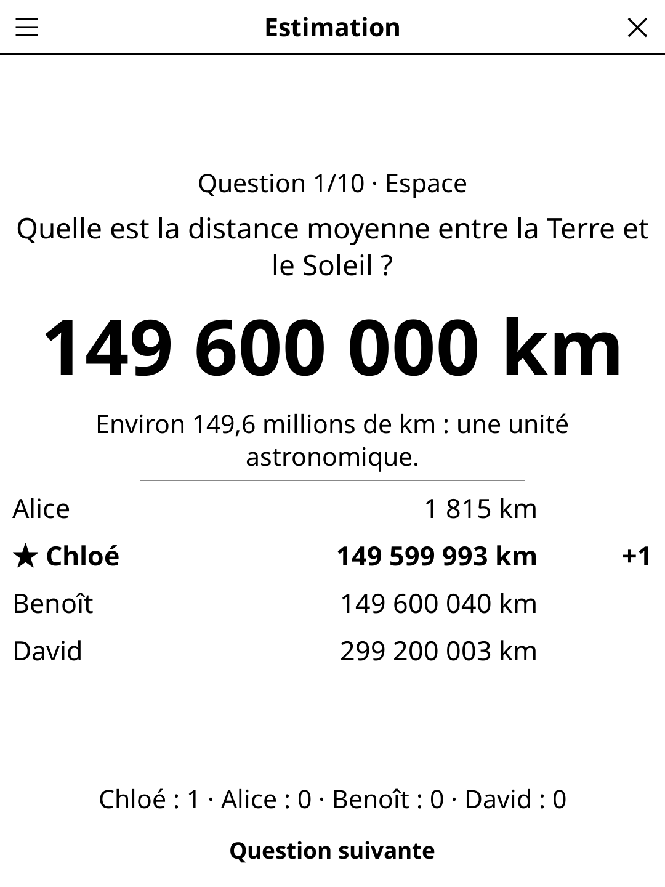

# estimation.koplugin

**Estimation** is a numeric trivia party game for [KOReader](https://github.com/koreader/koreader), for 2 to 8 players sharing one reader.

## Screenshot

## Concept

Every question has a number for an answer — *In which year did Napoleon die? How tall is the Burj Khalifa? How many bones in a human hand?* Nobody is expected to know it, only to be the closest. The reader goes round the table: each player types a secret guess on the number pad, then the true answer is revealed with every guess, sorted, and a one-line fact.

## Rules

- When your name shows, take the reader, tap **Ready**, type your guess (**±** makes it negative, for years BC), **Validate** and pass the reader on. Guesses stay secret until the reveal.
- **Scoring** (title-bar menu):
  - **Closest** — the closest guess scores 1 point, 2 for the exact answer; ties all score.
  - **Closest without going over** — the same, but guesses above the answer are out.
  - **Betting** — the sorted guesses become betting slots, plus *Lower than every guess*. Each player secretly places 1 or 2 chips. The winning slot is the highest guess that does not go over (or *Lower than every guess*); each chip on it pays the slot's odds (×2 in the middle, more towards the edges) and the author of the winning guess scores 3 points.
- 5, 10 or 15 questions per game; the highest score wins.

## Features

- **803 English and 811 French questions** in 16 categories (history, geography, monuments, famous people, science, nature, space, arts & culture, sport & games, food & drink, the human body, records, inventions, books & writers, cities of the world, and Paris & France / London & Britain), each with its unit and a short fact. Category filter in the menu.
- Every answer carries a source note in the data files (not shown in the game), and contested or yearly-changing figures were left out.
- Stable, well-established figures only (dates, heights, counts); approximate values are phrased "about…" and the fact gives the range.
- Questions already asked are remembered, so the next games draw fresh ones.
- Player names typed once and remembered; hand-over screen between players.
- Interface follows KOReader's language; questions have their own **Language** setting (FR/EN).
- A game in progress is saved; reopening it resumes on the current player's hand-over screen.

## Controls

| Screen | Action |
|---|---|
| Hand-over | Tap **Ready** (or anywhere on the card) |
| Guess | Number pad, **±**, **Erase**, **Validate** |
| Bet | Tap a slot to place a chip, **Remove chips**, **Confirm** |
| Reveal | **Next question** / **Final scores** |
| Game over | **New game** |
